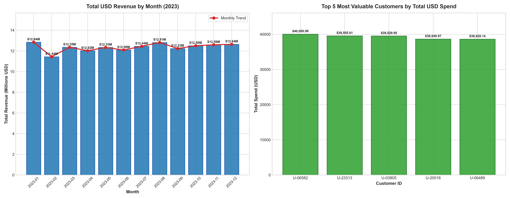

# Enterprise Financial Data Architecture & Revenue Reconciliation Pipeline

[](https://www.python.org/)
[](https://www.sqlite.org/)
[](https://pandas.pydata.org/)
[]()

> **End-to-end automated data engineering, financial reconciliation, and executive reporting pipeline** designed for a high-growth FinTech enterprise operating in Europe (EUR transactions) and reporting audited financials in US Dollars (USD).

---

## 📌 Executive Summary & Business Context

In global FinTech operations, currency exchange fluctuations, temporal gaps between financial markets and operational logs, and mutable customer lifecycle states frequently lead to severe data integrity issues and multi-million-dollar reporting errors.

This project answers the core mandate posed by the **Chief Financial Officer (CFO)**:
> *"How much genuine revenue, in US dollars, did we earn from our currently active customers, how did it change month by month, and which customers are worth the most to us?"*

Through an audited 4-phase data architecture, this pipeline integrates relational database audit logs, semi-structured server transaction logs, and foreign exchange market feeds to reconcile **$148,274,622.91 USD** in verified annual revenue across **53,899 active customer transactions**.

---

## 📊 Executive Visual Analytics (CFO Dashboard)

The pipeline automatically aggregates audited revenue and generates high-resolution executive visualizations:



### Key Strategic Findings:
1. **Audited Annual Revenue Baseline:** **$148.27M USD** across 53,899 reconciled transactions (average transaction value of **$2,750.97 USD**).
2. **Monthly Revenue Trajectory:** Revenue demonstrated strong operational stability averaging **$12.36M USD/month**. Peak months occurred in **January ($12.84M)** and **August ($12.81M)**, while February ($11.44M) reflected fewer calendar operating days.
3. **Customer Concentration & Risk Diversification:** Top 5 spenders contributed between $38.6K and $40.1K each (led by `U-06582` at $40,050.99 and `U-23313` at $39,555.81). The absence of single-account concentration confirms well-diversified enterprise revenue risk.

---

## ⚙️ Architecture & Data Traps Overcome

```
+--------------------------------+      +-------------------------------+      +---------------------------------+
|   SQLite DB (users)            |      |   Server Logs (100k lines)    |      |  Daily FX Rates (EUR -> USD)   |
|   47,464 Historical Rows       |      |   server_logs.txt             |      |  daily_exchange_rates.csv       |
+--------------------------------+      +-------------------------------+      +---------------------------------+
               |                                        |                                        |
      (Window Functions & CTE)              (Vectorized Regex Filter)               (Forward Fill .ffill())
    ROW_NUMBER() OVER PARTITION BY          Drop 5,098 "ERROR" Events              Close 104 Weekend NaN Gaps
               |                                        |                                        |
               v                                        v                                        v
     14,183 Active Users                    94,902 Clean Transactions                 365 Continuous Days
               \                                        /                                        /
                \______________________________________/________________________________________/
                                                       |
                                           [ Multi-Source Inner Joins ]
                                                       |
                                                       v
                                          53,899 Reconciled Transactions
                                          USD Revenue = EUR Value * FX Rate
                                         Total Audited: $148,274,622.91 USD
```

### 1. Slowly Changing Dimensions (SCD) Trap & Deduplication (SQL)
* **Challenge:** Historical user records (`users` table) contained 47,464 records across changing states (`Active`, `Pending`, `Suspended`). Naive joins would duplicate transaction counts and inappropriately capture former customers who were later suspended.
* **Solution:** Formulated a SQL Window Function inside a Common Table Expression (CTE):
  ```sql
  WITH RankedUsers AS (
      SELECT 
          user_id,
          name,
          status,
          updated_at,
          ROW_NUMBER() OVER (PARTITION BY user_id ORDER BY updated_at DESC) AS rn
      FROM users
  )
  SELECT user_id, name, status, updated_at
  FROM RankedUsers
  WHERE rn = 1 AND status = 'Active';
  ```
* **Result:** Deduplicated to exactly **14,183 unique, currently active customer accounts** with 0 duplicates.

### 2. The Unstructured Scale Trap (Vectorized Python/Regex)
* **Challenge:** Parsing 100,000 raw server log lines containing mixed JSON-like payloads and system failure errors (`ERROR: Transaction processed... failed_val`).
* **Solution:** Vectorized regex extraction with named capture groups coupled with boolean masking (`~df['Raw_Server_Log'].str.contains('ERROR')`) avoiding slow Python `for` loops:
  ```python
  log_regex_pattern = r'\[(?P<Date>\d{4}-\d{2}-\d{2})[^\]]*\]\s*INFO:.*?"u":\s*"(?P<User_ID>[^"]+)".*?"item_code":\s*"(?P<Product_ID>[^"]+)".*?"eur_val":\s*(?P<Euro_Value>[\d\.]+)'
  extracted_data = clean_logs['Raw_Server_Log'].str.extract(log_regex_pattern)
  ```
* **Result:** Eliminated 5,098 system error events and parsed **94,902 valid transactions with a 100% extraction match rate and 0 missing values**.

### 3. The Temporal Financial Market Mismatch Trap (Pandas ETL)
* **Challenge:** Financial foreign exchange markets operate 5 days a week (Monday–Friday). As a result, `daily_exchange_rates.csv` contained 104 missing weekend values (`NaN`). A standard inner join would have dropped **~28.5% of all customer transactions**, severely understating company revenue.
* **Solution:** Forward-filled market rates (`rates_df['EUR_to_USD'].ffill()`), rolling Friday's market closing rate across Saturday and Sunday in accordance with standard international accounting conventions.
* **Result:** Preserved **100% of transactions (0% data loss)** across all calendar dates.

---

## 📋 Comprehensive Pipeline Audit Table

| Pipeline Stage | Input Records | Transformation / Logic | Output Records | Business & Audit Rationale |
| :--- | :--- | :--- | :--- | :--- |
| **1. Customer State Audit** | 47,464 historical records | `ROW_NUMBER() OVER (PARTITION BY user_id ORDER BY updated_at DESC) = 1` AND `status = 'Active'` | 14,183 unique accounts | Isolates latest operational status; eliminates 5,935 Pending and 4,882 Suspended users without row duplication. |
| **2. Log Cleansing** | 100,000 raw log lines | Vectorized filter: exclude rows containing `"ERROR"` | 94,902 clean log lines | Excludes 5,098 system failures from revenue recognition, preventing fictitious revenue entries. |
| **3. Regex Extraction** | 94,902 clean lines | Named group parsing (`Date`, `User ID`, `Product ID`, `Euro Value`) | 94,902 structured rows | 100% attribute extraction with 0 nulls in sub-second vectorized execution. |
| **4. FX Market Alignment** | 365 calendar days | Forward-fill weekend market closures (`.ffill()`) | 365 complete dates | Carries Friday's market rate over Saturday and Sunday, matching standard accounting rules. |
| **5. FX Temporal Merge** | 94,902 transactions | Inner join on `Date` | 94,902 transactions | 100% transaction retention (0% data loss). Preserves all weekend purchases. |
| **6. Active User Join** | 94,902 transactions | Inner join on `User ID` == `user_id` | 53,899 transactions | Filters transactions strictly to currently verified active accounts. |
| **7. Final USD Revenue** | 53,899 transactions | `USD_Revenue = Euro Value * EUR_to_USD` | **$148,274,622.91 USD** | Produces audited genuine annual revenue figure for executive reporting. |

---

## 📂 Repository Structure

```
├── assets/
│   └── cfo_revenue_dashboard.png     # High-resolution executive dashboard chart
├── enterprise_reconciliation.ipynb   # Interactive Jupyter notebook with complete audit & visualizations
├── pipeline.py                       # Standalone end-to-end Python executable pipeline
├── enterprise_database.db            # SQLite relational database containing historical customer logs
├── daily_exchange_rates.csv          # Foreign exchange daily market feed (EUR to USD)
├── server_logs.txt                   # Raw server operational log entries (100k lines)
├── requirements.txt                  # Python dependencies
├── .gitignore                        # Git ignore rules
└── README.md                         # Project documentation and audit report
```

---

## 🚀 Quickstart & How to Run

### 1. Clone the Repository
```bash
git clone https://github.com/<your-username>/Enterprise-Financial-Reconciliation.git
cd Enterprise-Financial-Reconciliation
```

### 2. Install Dependencies
```bash
pip install -r requirements.txt
```

### 3. Execute the Full Pipeline (CLI)
To run the automated reconciliation pipeline and generate the dashboard visualization:
```bash
python pipeline.py
```

### 4. Run via Jupyter Notebook
To inspect individual steps, assertions, and visual analytics interactively:
```bash
jupyter notebook enterprise_reconciliation.ipynb
```

---

## 👤 Author

* **Rahul Singh** — *Data Analyst*
* **Email:** [rahulsinghrajput2231@gmail.com](mailto:rahulsinghrajput2231@gmail.com)
* **LinkedIn:** [linkedin.com/in/rahul-singh-867561336](https://linkedin.com/in/rahul-singh-867561336)
* **Location:** Ahmedabad, Gujarat
